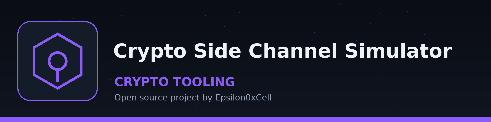

# crypto-side-channel-simulator

Runs basic cryptographic operations (RSA, AES, SHA-256/SHA-512 hashing, HMAC, and PBKDF2) and logs a simulated timing figure for each one: the measured wall clock time plus or minus a random variation of up to 10 percent. It is a timing simulation only. It does not measure power consumption and it does not perform an actual side-channel attack or recover any key material.

## Requirements

- Python 3
- cryptography 41.0.0 or newer (see requirements.txt)

## Install

```bash
git clone https://github.com/ShadowGuard-AI/crypto-side-channel-simulator.git
cd crypto-side-channel-simulator
pip install -r requirements.txt
```

## Usage

```bash
python3 main.py [-h] [--key_size KEY_SIZE] [--data_size DATA_SIZE] [--iterations ITERATIONS] [--debug] [--show_time] OPERATION
```

OPERATION is one of: `rsa_keygen`, `rsa_encrypt`, `rsa_decrypt`, `aes_encrypt`, `aes_decrypt`, `hash`, `hmac`, `pbkdf2`.

The program generates its own random keys and random input data internally, runs the selected operation once, and logs the simulated time. It does not print or save the resulting keys, ciphertext, or digests, so it is a timing demonstration, not a general purpose encryption tool.

For `rsa_encrypt` and `rsa_decrypt` the program first generates a fresh RSA key, then encrypts (and for `rsa_decrypt`, decrypts) random data of `--data_size` bytes. For `aes_decrypt` it first encrypts random data with a fresh AES-256 key, then decrypts it. RSA encryption uses PKCS#1 v1.5 padding, so the data size must fit the key: at most 245 bytes for a 2048 bit key or 117 bytes for a 1024 bit key.

## Parameters

- `-h`, `--help`: Show help message and exit.
- `--key_size`: RSA key size in bits (default: 2048). The help text says it only applies to `rsa_keygen`, but in the code it is also used for the key generated inside `rsa_encrypt` and `rsa_decrypt`.
- `--data_size`: Data size in bytes for encryption and hashing operations (default: 128).
- `--iterations`: Number of iterations for PBKDF2 (default: 1000).
- `--debug`: Enable debug logging.
- `--show_time`: Log an extra line noting that showing time is enabled. The simulated times are logged either way.

## Examples

```bash
python3 main.py rsa_keygen --key_size 1024
python3 main.py rsa_encrypt --key_size 1024 --data_size 32
python3 main.py rsa_decrypt --key_size 1024 --data_size 32
python3 main.py aes_encrypt
python3 main.py aes_decrypt
python3 main.py hash --data_size 64
python3 main.py hmac
python3 main.py pbkdf2 --iterations 500
```

Example output (timestamps and times vary):

```text
2026-10-30 13:49:35,411 - INFO - RSA encryption simulated time: 0.002892 seconds
```

## Limitations

- Errors during an operation (for example an RSA key size below 1024 bits, or data too large for the RSA key) are logged as errors and the program still exits with status 0.
- Only the SHA-256 code paths are reachable from the command line. SHA-512 variants exist in the library functions (`hash_simulation`, `hmac_simulation`, `pbkdf2_simulation`) but there is no command line flag to select them.
- AES uses CFB mode with a random IV that is returned by the library function but not printed by the command line program.
- There are no bundled tests.

## License

Copyright (c) ShadowStrikeHQ. No license file is included in this repository.
